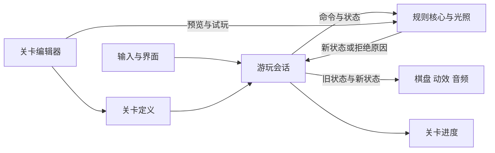

# Dracula’s Box 技术框架

> 配套：[设计基准](Design/Prototype设计文档.md)、[决策日志](DECISIONS.md)。系统策划案仅在真实需求明确并经所有者要求时按需建立。
> 本文只写代码无法充分表达的协作约定与扩展边界；技术版本声明见设计基准，实现细节见代码。

## 1. 基线与边界

- 正式原创项目暂定 Dracula’s Box，稳定工程标识为 `DraculasBox`。原创模块已在 `Assets/DraculasBox/` 建立，使用独立 Core / Runtime / Editor 程序集。
- 继承框架按需复用；本模块沿用研究模块的小职责组件和美术风格，运行规则与进度独立。
- 基础设计入口为 [项目文档导航](README.md)。规则数据与表现、编辑文档与试玩状态保持分离。
- 不预先引入新的架构层、依赖或数据方案；任何影响跨模块使用方式的取舍先形成明确决策。

## 2. 继承框架的使用约定

以下保留模板中与现有代码相符的通用约定，作为后续开发的默认方式；与具体需求冲突时先裁定再更新本节。

- 使用 `ConoBehavior` 体系时通过 `ManagedInitialize`、`ManagedOnEnable`、`ManagedOnDisable`、`ManagedDestroy` 参与生命周期，保留基类编排。
- `Singleton<T>` 限于确有全局职责的管理器，不将普通业务组件默认写成单例。
- 跨模块通知优先复用既有 Aya.Events 事件机制；模块内部保持直接、清晰的协作，避免为一次性逻辑过度封装。
- 新增运行时异步等待优先使用 UniTask；这不表示现存模板或编辑器工具已经统一改写。
- 高频生成与回收需求明确后优先复用既有对象池。性能目标与负载需经确认和测量，不将默认约定记作达标结论。

## 3. 模块与扩展约定

- 项目专属玩法放入项目业务层；只有可复用且确有需求的能力才扩展 CakePac，避免将单一玩法规则耦合进公共框架。
- 通用工具与项目玩法的职责边界发生变化时更新本文；具体类、字段与调用过程留在代码及必要注释中。
- 新系统先明确玩法规则与验收，再确定权威状态、模块依赖和扩展方式；不凭空建立空系统或占位策划案。
- 场景、预制体与资源引用修改需核查 Unity 序列化引用及 `.meta` 身份，保留无关资源的现有状态。

## 4. 验证边界

- 文档静态核对只能证明导航、归档和已记录事实的一致性。
- 编译、自动化测试、场景运行、构建与体验验收分别报告；未执行的检查不标为通过。
- 引擎或依赖调整属于独立变更，需先明确兼容目标和验证范围，不随文档维护附带实施。

## 5. 独立研究模块

`Assets/Studies/BoxOrVoid/` 使用单一共享场景承载菜单、剧情关卡和玩家编辑器。关卡是版本化数据，编辑状态与试玩状态分开，试玩复用同一纯规则核心；内置关卡、用户关卡及剧情进度分别管理。固定 UI 在场景中持有，棋盘与内容由数据生成。原创模块不依赖研究模块的玩法程序集或测试驱动器；本轮按所有者要求复用已有美术、字体与音频资源。资料与证据入口为 [研究模块说明](../Studies/BoxOrVoid/README.md)。

## 6 Dracula’s Box 基础模块

原创模块位于 `Assets/DraculasBox/`，独立说明与启动方式见 [Dracula’s Box](../DraculasBox/README.md)。一个共享场景承载菜单、四章共二十四个主线、六个可选支线与编辑器，关卡由 JSON 数据加载。

| 模块职责 | 负责内容 | 边界 |
|---|---|---|
| 关卡定义 | 地形、棺材、初始角色、箱子与点光灯、镜向、太阳参数、压力板与门的连接组 | 静态数据，不保存运行时 Transform |
| 规则核心 | 走推、承重与门、太阳遮挡、点光射线与镜面反射、安全与通关判定 | 确定性普通 C#，不依赖动画或材质 |
| 游玩会话 | 当前状态、命令执行、撤销与重置、当前关卡 | 管理完整局面，不从画面反读坐标 |
| 表现与输入 | 输入命令、棋盘显示、Juicy 动效、音频与 UI | 表现不参与规则判定 |
| 关卡与进度 | 关卡目录、当前选择、完成记录与设置 | 与研究模块和编辑试玩的记录分开 |
| 关卡编辑器 | 编辑文档、历史、摆放、预览与独立试玩 | 复用规则核心，试玩不污染编辑原稿 |

音频由 `GameAudio` 持有：主配乐和编辑配乐通过 `GameAssets` 显式引用，音效使用原有独立音量与播放源。页面编排只选择音乐上下文，两首循环各自连续推进，以短交叉淡化切换；暂停、设置、确认框与编辑试玩保留原上下文。配乐不进入规则状态或撤销快照，备选素材不进入运行资源引用。

主题配置属于表现层，不进入关卡定义、规则状态或撤销快照。主题标识与音量一起存入进度设置；新进度、缺省主题和无效标识使用酒红，已保存的有效选择继续沿用。切换时原位更新设置控件，棋盘从同一局面重建表现；保留游玩历史、编辑文档与视口。生成美术与缩略图按主题缓存，导入贴图保持原文件；场景制作入口固定使用酒红，避免将个人设置写进工程。

## 7 状态与基本数据流

静态关卡保存棋盘、固定目标、初始角色与箱子、点光灯，以及太阳开关和来源方向。动态状态保存角色、箱子与点光灯的位置及当前太阳状态，撤销面向完整快照。对象使用稳定 ID。朝向、插值与挤压属于表现，不决定安全或碰撞。

当前状态快照已保留太阳开关与方向，只从关卡配置初始化，不提供改变时段的场内机关。章节目录与单关数据分开，节点记录主支线及前置依赖。主线完成数和下一关选择只遍历主线，同章推进在章末停止。首次完成全部主线时，由编排层记录本次完成事件并返回本章图，表现层播放已完成节点序列；完成记录与章节解锁先持久化，不依赖动画回调。重玩不会重复整章庆祝。支线按指定节点解锁，通关返回本章选关。进度存储稳定关卡标识，保留旧完成记录和已解锁章节；已完成节点始终可重玩，新玩家仍按当前前置条件推进。续玩位置失效时转到已解锁章节的未完成主线，不将关卡编号重新分配给另一谜题。

同关的点光灯使用独立实体和稳定 ID，编辑器连续放置不会挪走已有灯。规则分别累加所有光源的危险格，并保留每格的水平、竖直点光方向；表现按危险并集提亮统一地面，每盏灯的光晕跟随自身实体。遮挡一盏灯后重新计算整份并集，不能直接清空其原光路上的危险标记。

镜向是静态实体类型，追加枚举值以保留既有 JSON 数值身份。灯光按格与入射方向遍历，遇镜改变方向；同一光源重复到达相同的有向格时停止重复路径，避免环路。镜面入射边和反射边由核心累加后交给表现层，表现只绘制折线，不自行判断光照或安全。镜子沿用实体位置快照与承重规则，试玩和编辑预览共用同一反射计算。

一次方向命令由会话送入规则核心，先计划完整的箱子或点光灯移动；仅地形或实体链碰撞会拒绝走推。可通行时整体提交，再更新机关和光照，先判断死亡，只有存活且落在棺材格才通关；棺材不豁免受光。死亡局面不可继续走动，但保留在完整历史中供撤销；位移、死亡反馈和提示由表现与编排层处理。不能通过多个物理碰撞回调逐个提交物体。

压力板和门是可选的静态地板机关，旧关卡缺省为空，不改变原有 JSON 版本。门的开闭由完整局面中的承重、连接组和门格占用推导，避免另存一套会漂移的机关状态。通行先使用本步开始时的门状态；提交后更新承重与门，最后计算光照和生存。撤销、编辑预览、保存导入与独立试玩均走同一规则。编辑器允许暂时未配对的机关草稿，试玩前要求组内存在对应压力板和门。

撤销和重置面向完整状态快照，恢复后重算太阳与点光灯的危险区域。连续输入、动画取消和页面切换由会话与表现协调，不允许把动画中间位置当成棋盘状态。具体输入节奏在实施时细化。

关卡共用运行入口，按数据加载，不为每关建立单独场景。编辑状态和试玩状态分开；编辑预览与正式游玩采用同一套光照规则。

编辑器保存独立原稿和分组绘制历史，试玩复制原稿创建会话，返回时恢复原稿、历史与视图。脏状态比较完整内容与磁盘基准；保存、离开或试玩前先提交文本和未结束的笔画。选择以单物件层或矩形全层表达，移动预览在副本上完成，释放后整体校验并提交一次历史；区域重叠按原快照平移，越界、占用及取消不覆盖原稿，实体 ID 与机关连接组随选区保留。拖拽绘制离开画布时断开插值，重新进入不补画跨越区域；越界缩减尺寸不修改原稿。预览按帧合并刷新，棋盘显示对象复用并显式绑定精灵纹理；画布缩放与平移不改变格子坐标，视口裁剪只作用于表现。

工具快捷键与按钮共用编辑操作入口，文字输入时屏蔽绘制快捷键；界面直接标注按键。缺口预览按相邻缺口掩码生成外围深坑边缘，满格填充以消除内部缝隙，缩略图同步处理，不改变地形规则。正式目录拖拽按节点中心与抓取偏移选择插入位置，主支线间保留稳定区间；预览只修改表现，松手后才以一次文档事务提交，Esc 或越界取消。节点菜单替代独立操作页面，目录与关卡草稿的历史边界保持不变。空格预览读取工作目录中的棋盘数据，复用实际光照核心的缩略图；拦截该键的菜单确认行为，小窗不参与鼠标命中，不启动试玩或修改草稿。

结构校验由规则核心统一提供：可编辑草稿允许角色或棺材尚未放置，但不接受重叠、越界实体、无效方向或不规则地图；试玩还检查角色、棺材与安全出生点。结构合法不等于谜题有解。文件读取在大小限制内解析，校验成功后才能生成预览；关卡库标识与文件名对应。写入使用独立临时文件和替换备份，失败时保留当前原稿及旧文件，并向使用者显示错误。

求解器在棋盘快照上用 A* 搜索，以忽略物件与危险区时到棺材的地板距离作为步数下界。每条边执行实际移动规则，状态键包含玩家与各物件的位置。搜索有时间、状态数和取消边界。生成器组合可旋转、翻转的局部谜题，在完整棋盘复演路线，通过后才交给编辑器预览。后台计算只处理纯数据，关闭工具或切换棋盘会丢弃过期结果。

自制关卡的可选 `solution` 字段随保存、恢复和 JSON 导入导出流转，旧文件可直接打开。正式关卡沿用 `Replays.json`，编辑时取出对应路线，写回时验证后保留有效的较短解。播放使用独立会话，复用棋盘动画。采用生成稿保留原关卡标识与名称，以及正式目录中的章节位置和解锁关系。

正式目录写回先比较工程基准与工作快照，按勾选项合成候选目录；章节名称、顺序、逐关新增／删除／编排、标题、棋盘与解法分别表达。校验完整图关系，但只为新增或布局／路线变化的棋盘要求有效路线；元数据修改不受无关草稿阻挡。实际复演得到推数，旧派生数值不作为拒绝理由，修正也列入评审。候选版本保留工程版本检查与多文件回滚；导入后保存以新版本为基准的剩余草稿，保存失败也回滚工程。未勾选工作不丢弃，全部写回后清理草稿；比较数据时忽略棋盘和回放文件列表的装载顺序。显示编号从章节图即时推导，和稳定 ID、可编辑标题分离。

关卡库将明确选中的关卡与悬停焦点分开，预览及文件操作绑定选中标识。导入在覆盖关卡库的弹窗内解析并预览，确认后生成新标识；路径修改与弹窗关闭使旧结果失效。导出弹窗保留编辑视口和文档，仅展示实际写出结果；移除转入本地回收区，重新打开后仍可恢复，恢复冲突不覆盖已有版本。恢复草稿只展示有别于已保存内容的记录；损坏时尝试上一份完整备份，明确放弃后不再自动恢复。自制关卡、草稿恢复与主线进度分别保存，自动化使用临时存档目录，不写真实玩家进度。

复制正式关卡使用选择器确认的稳定标识，读取对应棋盘与回放，生成新标识后作为未保存原稿打开，不依赖最近游玩位置。清除进度先构造保留偏好的新记录，原子写入成功后才替换内存状态；失败时保留旧状态。清除过程不访问自制关卡、编辑草稿或正式目录。全关解锁使用独立可选标记，旧存档缺省关闭，同时作用于章节和节点可玩性，不写入通关记录；清除进度时一并复位。两个操作共用长按确认；充能缩放与颤动只作用于文本子节点，按钮命中区域不随之移动，粒子按实际文字边界分布。先持久化、再更新内存与完成反馈，动画不承担存档事务。

## 8 复用与扩展边界

现有研究模块可提供输入重复、动作编排、UI、转场、画笔历史、数据保存和编辑试玩返回等参考。复用以提取或适配小职责为主，原创模块不通过研究单例、研究检查器或原作程序集运行。

旧核心围绕黑白控制、实体层序和颜色目标；本作需要太阳方向、实体遮挡、两格箱影、四向点光射线与镜面反射，不能直接换皮继承旧规则。旧编辑数据的颜色与深度字段不自动进入新格式。

后续时段组件可以修改太阳状态，规则层重新计算日照与箱影；点光灯状态独立于昼夜，始终按四向射线规则判定。表现层同步显示各光源及危险区域。本轮不预设组件触发方式、具体关卡或复杂框架。
