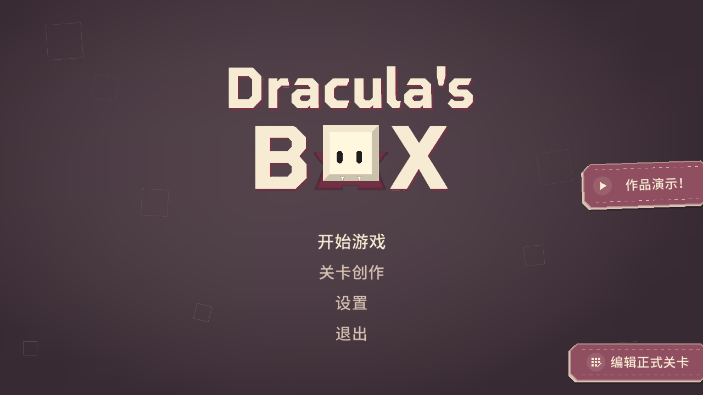
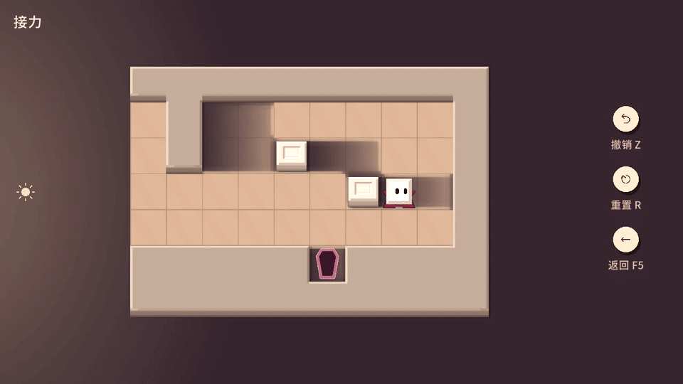
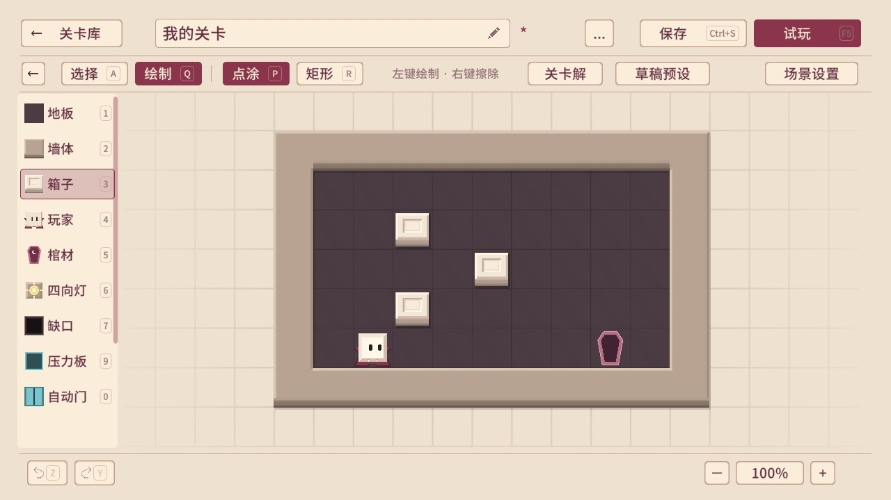
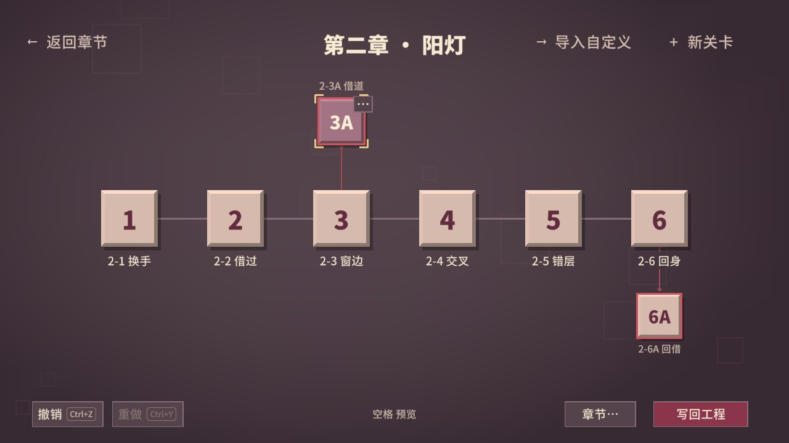
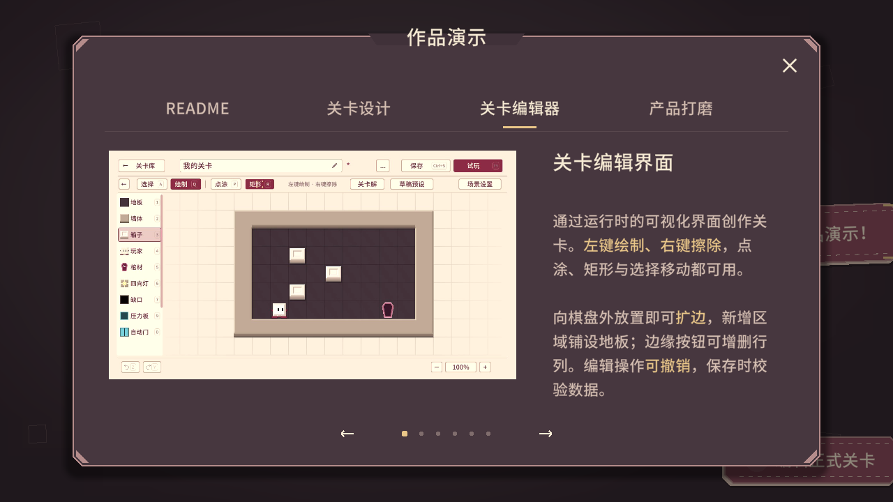

# Dracula’s Box

一款围绕光与影的推箱子解谜游戏，也是一个**技术策划求职 Demo**。操控小吸血鬼，搬动箱子、改变光路，安全回到棺材。

项目包含四个章节、玩家关卡编辑器，以及在 Unity 内使用的正式关卡编排与作品演示工具。

## 打开与体验

1. 用 **Unity 6000.3.6f1** 打开仓库根目录，等待首次资源导入与脚本编译完成。
2. 打开场景 [`Assets/DraculasBox/Scenes/DraculasBox.unity`](Assets/DraculasBox/Scenes/DraculasBox.unity)。
3. 进入 **Play 模式**，在 Game 窗口中操作。

> [!IMPORTANT]
> **Unity 编辑器专用入口**
>
> 「编辑正式关卡」与「作品演示」只面向 Unity 编辑器：未 Play 时可在主菜单预览中看到入口，进入 Play 后使用。独立运行的游戏包不提供这两个入口。
>
> **游戏包可用：** 玩家使用的「关卡创作」是另一个入口，在独立运行的游戏包中同样可用。

| 想体验的内容 | 主菜单入口 |
| --- | --- |
| 游戏与关卡 | **开始游戏** |
| 自定义关卡制作 | **关卡创作** |
| 正式章节与关卡编排 | 右下角 **编辑正式关卡** · 在 Unity Play 中使用 |
| 项目功能介绍与实机演示 | 右侧 **作品演示！**，或按 **F1** · 在 Unity Play 中使用 |

初次查看可先打开「作品演示！」，再试玩第一章。需要直接查看后续章节时，可在主菜单「设置」中长按「解锁所有关卡」。

## 游戏玩法

**目标是让吸血鬼进入没有受光的棺材。** 箱子既是障碍，也是可以搬动的遮蔽物；推动它们，会同时改变通路和安全区域。

| 元素 | 规则 |
| --- | --- |
| 阳光与箱影 | 阳光从关卡设定的方向照入；普通箱子与同高墙体在背光侧投下 **两格阴影**。 |
| 四向灯 | 沿上下左右照射，遇遮挡停止。灯可以推动，也可以隔着箱子间接推动。 |
| 压力板与门 | 玩家或物件压住压力板，会打开同组的门；开门也可能让光线穿过。 |
| 斜镜 | 镜向固定，可以推动，将灯光转向 90°。 |
| 光与棺材 | 走进光里会死亡，可以撤销。**棺材受光时同样危险**，不能直接通关。 |

方向键 / **WASD** 行走与推动，**Z** 撤销，**R** 重置，**Esc** 暂停。

当前正式目录包含 **24 个主线关卡、6 个可选支线关卡**。完成一章全部主线后，会回到本章关卡图播放完成演出，并解锁下一章；支线不影响章节推进。

## 关卡创作

从主菜单进入「关卡创作」，新建关卡，或使用「草稿预设」「复制主线」「导入」作为起点。「复制主线」会先打开章节与关卡选择，不会修改正式关卡。

### 制作一关

1. 在「场景设置」调整棋盘大小、阳光开关与照射方向。
2. 从左侧选择素材，绘制地形、放置物件；使用「选择」移动已有内容。
3. 按 **F5** 试玩，再按 **F5** 返回编辑。原稿、撤销历史与视图都会保留。
4. 按 **Ctrl+S** 保存到「我的关卡」；需要分享时，在关卡库的「…」菜单中导出 JSON。

| 编辑操作 | 快捷键 / 鼠标 |
| --- | --- |
| 选择 / 绘制 | **A / Q** |
| 绘制 / 擦除 | **鼠标左键 / 右键** |
| 点涂 / 矩形（绘制模式） | **P / R** |
| 移动选中内容 / 删除选中内容 | 拖动选区 / **Delete** |
| 平移 / 缩放画布 | 按住鼠标中键拖动 / 滚轮 |
| 撤销 / 重做 | **Z / Y** |
| 保存 / 试玩与返回 | **Ctrl+S / F5** |

绘制模式中，左键放置、右键擦除，均支持点涂与矩形；一次拖动作为一次撤销。选择模式中可直接拖动物件，或从空地框选区域后移动，空隙不会覆盖其他物件。压力板与门使用相同连接组配对。

在棋盘外绘制可自动扩展边界，新增区域默认铺设空地板；悬停棋盘上方或左侧边缘，用 `＋` 在对应行列之后插入，用 `−` 删除对应行列。删除内容可整体撤销，棋盘尺寸范围为 3–32 格。

顶部「… → 备注」可记录设计意图或待办，备注显示在编辑器底栏，过长时省略显示。

「关卡解」可以计算可行路线，并播放、暂停或逐步回看；修改布局后会重新验证已有解。搜索达到时间或状态上限时，只表示本次未找到解，不等于确认无解。

「草稿预设」提供 38 个紧凑棋盘，覆盖 12 种可选机制组合的Ⅰ、Ⅱ、Ⅲ档，按勾选机制与难度严格匹配；四项机制均不勾选时，筛选不含光照和机关的基础推箱子关卡，无对应预设时显示「暂无匹配草稿」。预览后采用，仍可自由修改或一次撤销。难度使用罗马数字，作为创作参考。

## 正式关卡编辑 · 仅 Unity Play

主菜单右下角「编辑正式关卡」用于维护项目实际使用的章节目录。它与玩家关卡编辑器共用棋盘编辑能力，并增加章节、顺序、主支线和写回工程功能。

| 制作需求 | 操作 |
| --- | --- |
| 修改棋盘 | 单击关卡格进入编辑；顶部名称框可改名。 |
| 快速查看关卡 | 鼠标悬停关卡格，按住 **空格** 打开小窗预览。 |
| 调整顺序与主支线 | 拖入横排间隙调整主线顺序；拖到主线格上方或下方，挂为该关解锁的支线。 |
| 管理章节 | 章节的「…」菜单中改名、调整顺序或删除。 |
| 使用预创作关卡 | 「导入自定义」从已保存的「我的关卡」中选择，创建独立的正式关卡副本。 |
| 复制、跨章移动或删除关卡 | 关卡格的「…」菜单。 |
| 移至玩家关卡库 | 关卡格「… → 移至创作关卡」：保存到「我的关卡」，并从正式目录草稿移出；目录变更仍需写回工程。 |

**保存草稿与写回工程是两步操作。** 草稿用于保留编辑中的工作；完成后，在关卡图点击「写回工程」，勾选需要提交的条目，再点「写回所选」。

新建或修改布局的关卡需要有有效通关路线，可通过求解或 F5 试玩通关获得。校验问题会显示具体原因；可以取消勾选有问题的条目，先写回其他修改，未选内容仍留在草稿中。

写回会更新 [`Content/Chapters.json`](Assets/DraculasBox/Content/Chapters.json)、[`Content/Levels/`](Assets/DraculasBox/Content/Levels/) 与 [`Content/Replays.json`](Assets/DraculasBox/Content/Replays.json)。这些才是需要随工程提交的正式内容；尚未写回的工作草稿保存在本机 `Library/DraculasBoxCampaign/`。

## 作品演示 · 仅 Unity Play

主菜单右侧「作品演示！」打开游戏内演示窗口，使用实际 Unity 录制片段介绍项目。可以先了解功能，再关闭窗口亲自操作。

- **README**：项目简介、演示用法与作者署名。
- **关卡设计**：吸血鬼与光影的核心规则、箱影接力、推移光源、开门与遮光、镜面反射。
- **关卡编辑器**：绘制与选择、随时试玩、求解与回放、草稿预设、正式关卡编排、从自定义关卡到工程写回。
- **产品打磨**：动作与撤销反馈、主题与界面交互、章节完成流程。

四个页签共 15 页。首次打开显示 [README 首页](Document/Images/Readme/showcase-intro.png)。点击页签或按 **Tab** 切换分类，左右箭头翻页，**空格** 暂停 / 播放，**Esc** 关闭。

演示配置、视频和封面位于 [`Assets/DraculasBox/Showcase/Editor/`](Assets/DraculasBox/Showcase/Editor/)，不随游戏包分发。正文与分段由 `Pages.json` 配置，`highlights` 指定随主题配色变化的强调词句；详见[演示素材说明](Assets/DraculasBox/Showcase/Editor/README.md)。

## 工程简要说明

关卡采用 **JSON 数据驱动**，由同一个场景加载和呈现。核心规则与 Unity 显示层分离，游玩、编辑预览、求解和回放共用规则。

| 目录 | 职责 |
| --- | --- |
| [`Assets/DraculasBox/Core/`](Assets/DraculasBox/Core/) | 纯 C# 棋盘状态、移动与光照规则、撤销、编辑数据、求解与草稿预设。 |
| [`Assets/DraculasBox/Runtime/`](Assets/DraculasBox/Runtime/) | 游戏流程、输入、棋盘表现、UI、音频与玩家关卡编辑器。 |
| [`Assets/DraculasBox/Editor/`](Assets/DraculasBox/Editor/) | Unity 编辑器专用的正式内容编排、校验与写回工具。 |
| [`Assets/DraculasBox/Content/`](Assets/DraculasBox/Content/) | 章节关系、关卡棋盘与通关路线。 |
| [`Assets/DraculasBox/Showcase/Editor/`](Assets/DraculasBox/Showcase/Editor/) | 仅在 Unity Play 使用的作品演示素材与配置。 |
| [`Document/`](Document/README.md) | 设计基准、技术框架、决策与开发记录。 |

进一步阅读：[设计基准](Document/Design/Prototype设计文档.md) · [技术框架](Document/技术框架.md) · [开发状态](Document/版本开发文档.md)

## 参考与素材

项目复用了部分**Box or Void**几何素材、字体、音效与交互基础；Dracula’s Box 的光影玩法与制作工具在 [`Assets/DraculasBox/`](Assets/DraculasBox/) 中独立实现。

主配乐为 Eric Matyas 的 **Hypnotic Jewels**，编辑器配乐为 rezoner 的 **Puzzle Tune 1 — B**。来源、署名与许可见 [音乐素材说明](Assets/DraculasBox/Art/Audio/Music/CREDITS.txt)。
