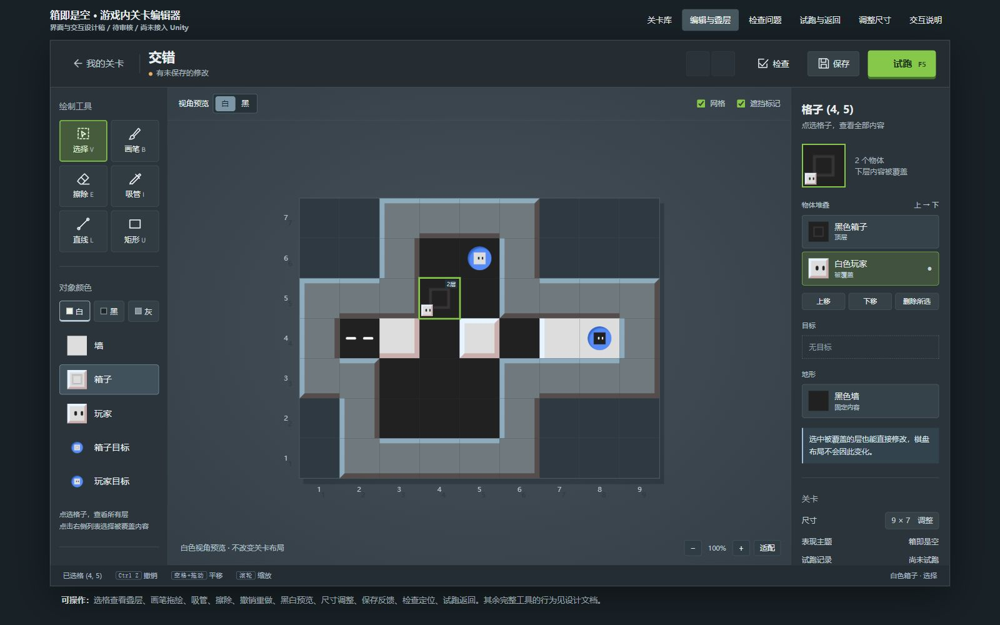
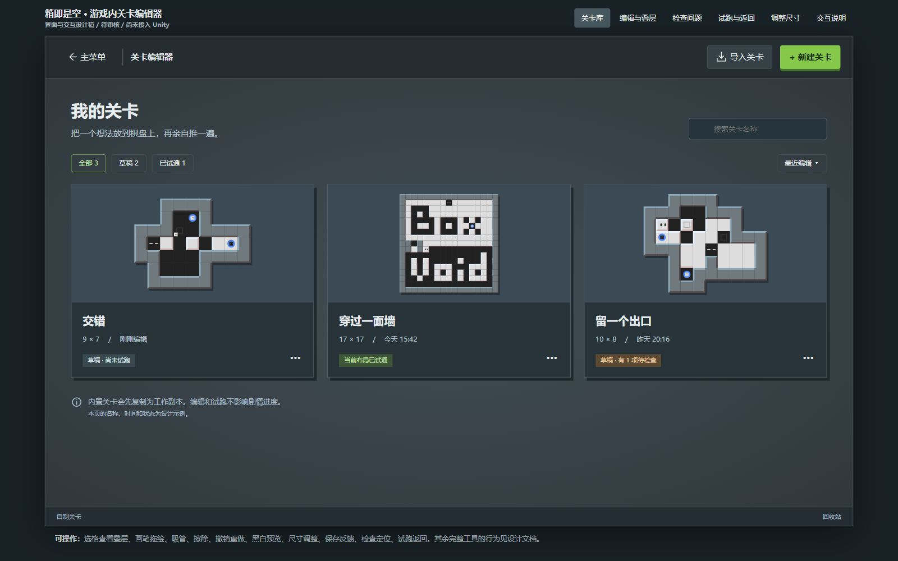
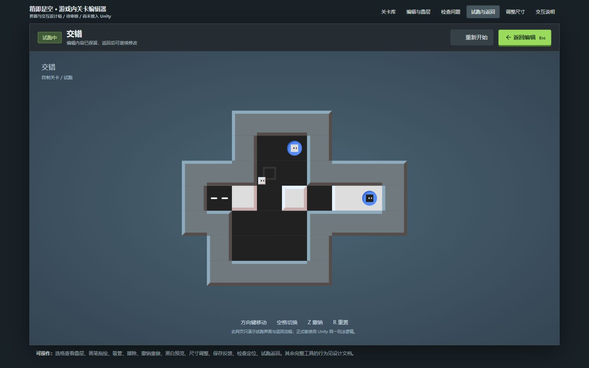
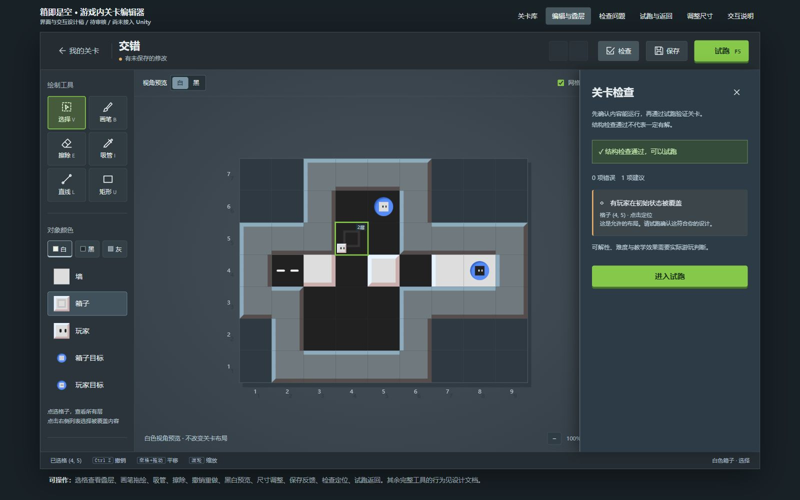
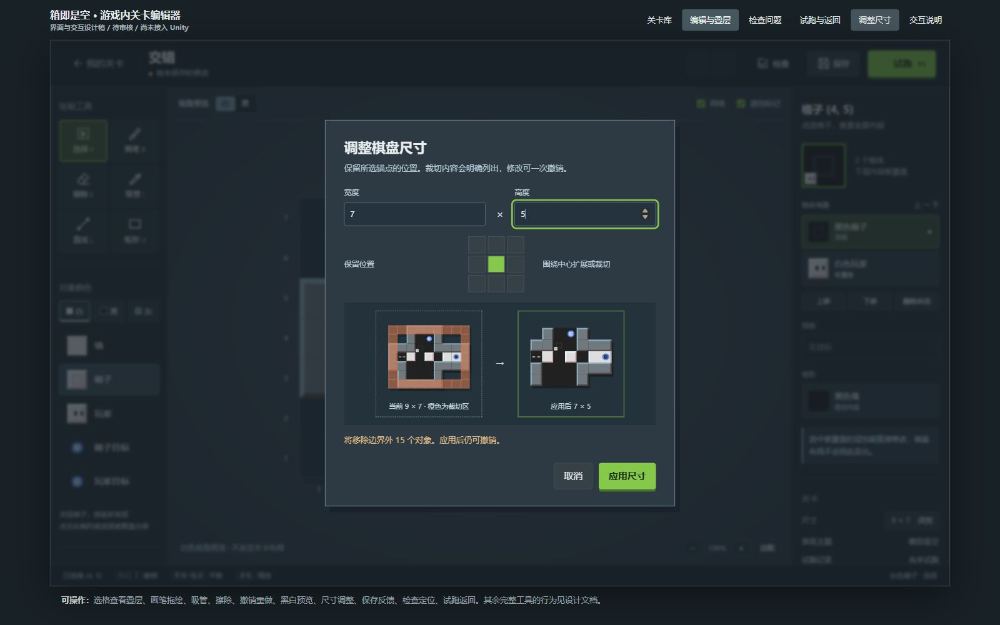

# 游戏内关卡编辑器审核入口

**状态：提案，等待审核。** 当前完整编辑器没有接入 Unity；原来的 LevelWorkbench 仍是 Unity Editor 内的 JSON 辅助工具。

直接双击 [editor-review.html](editor-review.html) 可离线打开，也可访问本次启动的本地预览服务 `http://127.0.0.1:8736/editor-review.html`。页面依赖同目录 `review-assets.js`；它只包含已有研究素材和布局。顶部是设计稿导航，正式游戏不包含它。

建议检查顺序：

1. 关卡库：进入编辑、查看关卡状态与文件操作的位置。
2. 编辑与叠层：默认示例将白玩家放在黑箱下。点右侧白玩家可选择被遮挡内容；删除后按检查会报告缺少白玩家，Ctrl+Z 恢复。
3. 画笔：选左侧箱子，在空格绘制，再撤销/重做。右侧明确区分地形、目标与可动物体。
4. 试跑与返回：体验圆形转场与编辑/游玩 UI 的切换。网页不模拟游戏核心，正式版计划共用 Unity Core。
5. 调整尺寸：查看锚点、受影响数量和二次裁切确认。取消或 Ctrl+Z 不应丢失原布局。

[TD 需求、交互及验收](TD设计稿.md) 说明完整首版的绘制工具、选区变换、存档恢复、导入导出、数据模型与实施顺序。样机只实现了审核所需的代表性交互；真实存档、玩法、填充与选区变换尚未接入。

## 界面稿

请重点审核：三栏布局是否顺手、层次区分是否明确、编辑与试跑的往返方式是否符合预期。通过后再开始完整 Unity 实现。
