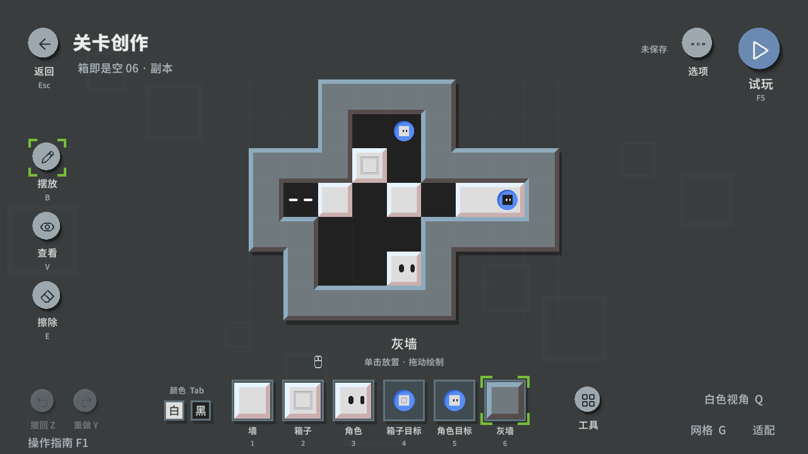
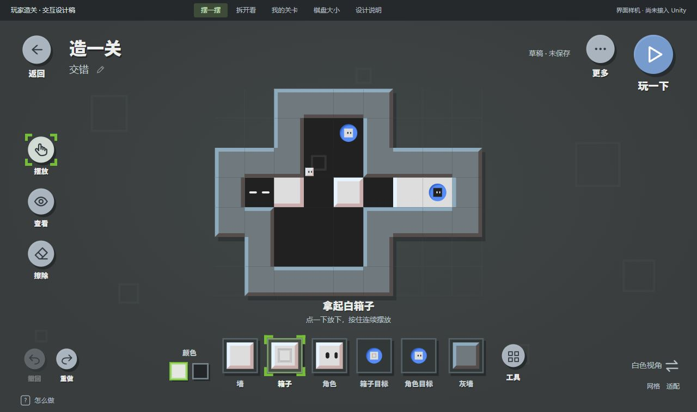
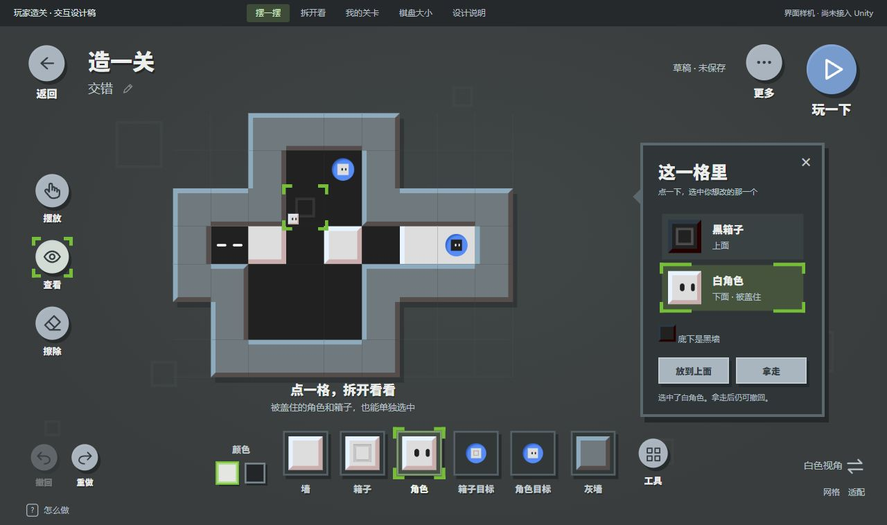
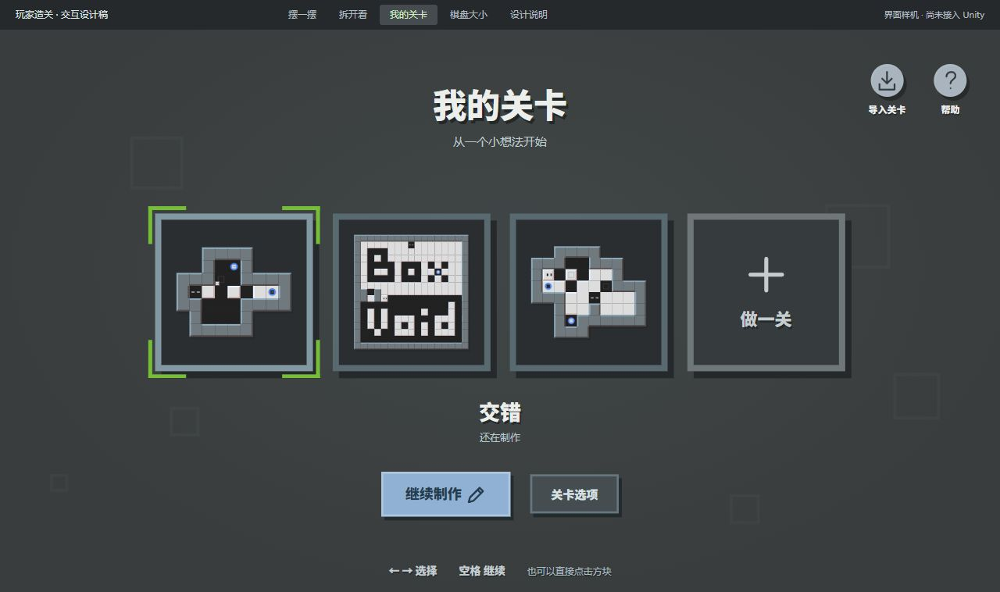
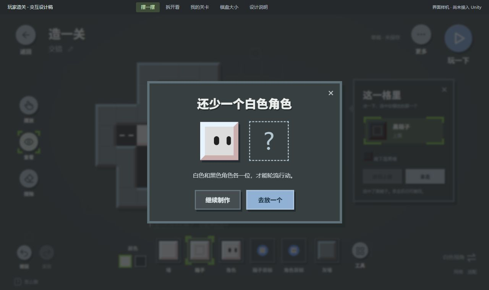
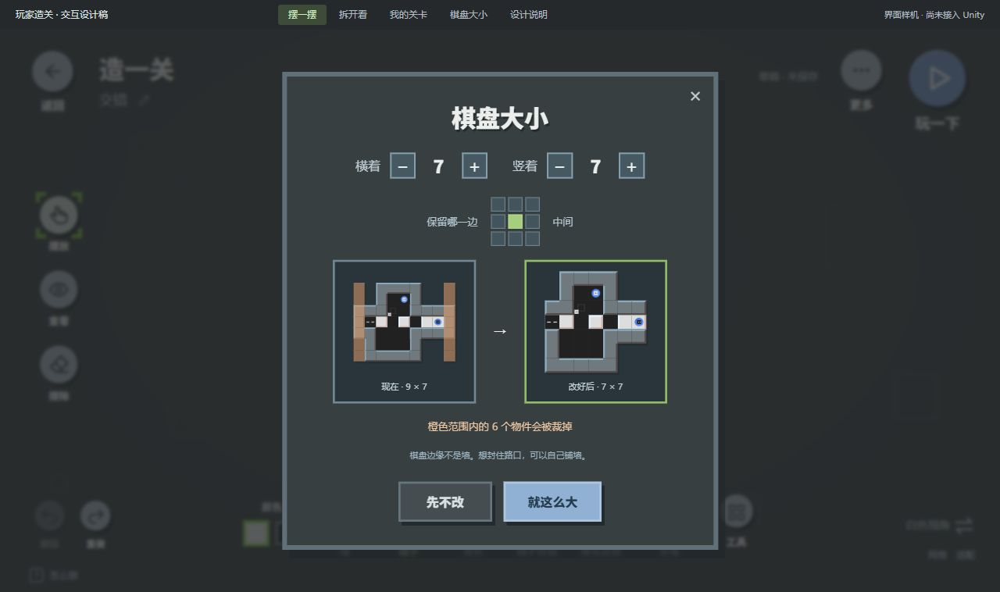
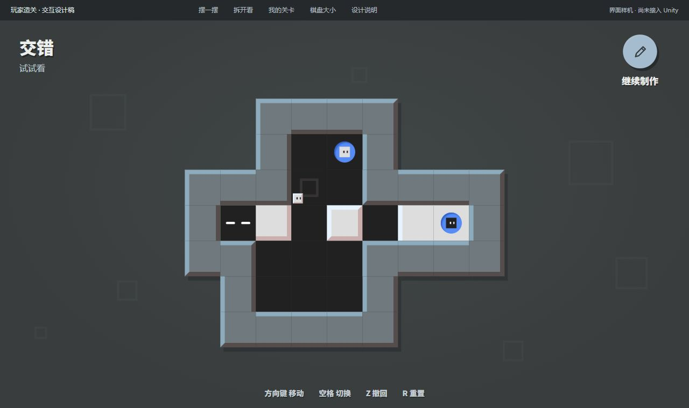

# 玩家关卡编辑器：设计与实机

2026-11-07 · **所有者已确认玩家界面方向并授权实现，现已接入 Unity。** 从游戏主菜单「关卡创作」进入。实现范围、操作、验证和限制见 [实施记录](实施记录.md) 与 [模块说明](../../README.md#游戏内关卡编辑器)。以下 HTML 和 JPG 保留为设计过程档案，当前产品以 Unity 实机为准。

文字已按后续反馈调整：主标题「关卡创作」，操作「试玩 / 返回编辑 / 选项」，物件提示采用「灰墙」配「单击放置 · 拖动绘制」。正文使用思源黑体中等字重，大标题保留游戏原有粗体；高频操作直接显示键位。

## 已批准的界面稿档案

打开 [可交互界面稿](editor-review.html)，或访问本地预览 `http://127.0.0.1:8736/editor-review.html?rev=player`。双击 HTML 可离线使用，需保留同目录 CSS、JS、素材包与字体。顶部细条是审核导航，正式游戏不包含它。

本稿的操作中心是“拿起→放下→玩一下”。棋盘、底部物件、圆形按钮、绿色四角选框和选关式卡片共同构成游戏内的造关模式。叠层内容只在查看格子时展开；保存、尺寸、批量制作和分享通过第二层菜单进入。

建议检查：

1. **摆一摆**：点底部箱子，再点空格放下，使用左下撤回/重做。改变左侧的摆放/查看/擦除模式，观察提示变化。
2. **拆开看**：初始示例在黑箱下面放有白角色。点击“下面·被盖住”的白角色，再点“拿走”。只有选中的对象被移除。
3. **修复问题**：移除白角色后点“玩一下”，会显示“还少一个白色角色”。点“去放一个”直接拿起正确角色；撤回可恢复原叠层。
4. **我的关卡**：使用选关式方块卡片，左右或鼠标选关，继续制作；点空白“做一关”开始新草稿。
5. **棋盘大小**：查看调整前后对比、保留位置和橙色裁切范围；裁切需再次确认，完成后能一步撤回。
6. **玩一下→继续制作**：体验圆形转场和制作/游玩 UI 的切换。编辑历史与布局保留，网页不模拟推箱子核心。

[TD 设计稿](TD设计稿.md) 保留完整首版的绘制、选区变换、草稿恢复、数据模型、共享规则核心及验收要求；[本轮视觉与交互修订](玩家造关UI修订.md) 说明玩家方向的布局和设计判断。

## 界面稿

## 样机边界与验证

样机可操作摆放、擦除、取物件、直线/矩形、地形填充、单格叠层选择与调序、撤回重做、尺寸裁切、命名、浏览器草稿保存/找回，以及示例文件导出。关卡库中的样例切换和新建为本页面会话内数据；复制/回收/导入流程、选区变换目前为交互示意。网页仅保存最近一个浏览器草稿，不能代替正式关卡存档。

上述限制仅指 HTML 样机。Unity 已另行实现持久关卡库、原子存档与恢复、完整选区操作、同一 Core 的试玩与通关记录，具体证据见实施记录；不能将网页按钮可点击作为 Unity 交付证据。

本轮已通过浏览器真实点击验证：摆放/撤回/重做，遮挡对象选择，缺角色后的笔刷引导，游玩界面往返保留历史，示例关卡切换，裁切确认和一步恢复。1280×720、1920×1080 游戏画面均无横向页面溢出；图片正常载入，所检查路径没有浏览器错误。记录见 [player-review-checks.json](player-review-checks.json)。这些检查不替代所有者的美学与体验审核。

旧三栏工作台稿件保留于 [Archive/2026-11-06-workbench](Archive/2026-11-06-workbench/)，不再作为当前视觉方向。设计批准与最终产品体验验收分别记录。
